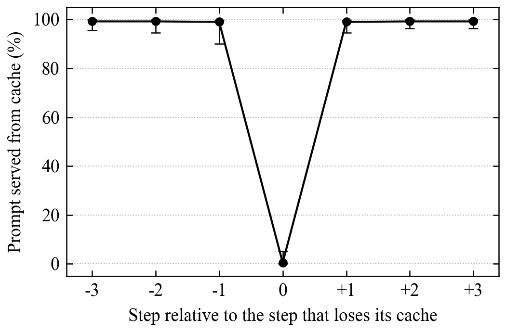

# Tool loops and the prompt cache

If you're reading this, you were curious about my results. Cool :) How it was made: I used Claude to write the analysis code and draft the text. I reran everything and checked each number against the script's output myself, so any mistakes are mine.

I went through the [FreeInference agentic trace](https://huggingface.co/datasets/harvardMadsys/freeinference_agentic_trace) to see what happens to the prompt cache while an agent waits on a tool.



**Figure 1. The prompt cache is lost for a single step.** Share of each prompt served from cache at the steps around a cache loss (step 0), defined as a tool-loop step where less than half of the previous prompt is served from cache. Points are medians and bars span the quartiles (n = 3,463 at step 0; 3,024 to 3,231 at the others). Steps are selected only by the condition at step 0; neighbouring steps are not conditioned on.

Two things came out of it:

- After the model asks for a tool, the next request is back within a minute 95.8% of the time, with almost the same prompt.
- Even so, 1 in 295 of those steps loses more than half of its cached prompt and usually has it back one step later. Together they are 10.7% of all uncached tokens in the trace.

[NOTE.md](NOTE.md) has the details and what I can't tell from the trace alone.

## Run it

```
pip install duckdb huggingface_hub
huggingface-cli download harvardMadsys/freeinference_agentic_trace --repo-type dataset \
  --include "release/*/processed/requests.parquet" "release/*/processed/sessions.parquet" --local-dir data
python numbers.py data
```

`python figure.py` redraws the figure (it needs `matplotlib`).

It takes a few minutes and should print what is in [expected.txt](expected.txt).

Marc Frances
